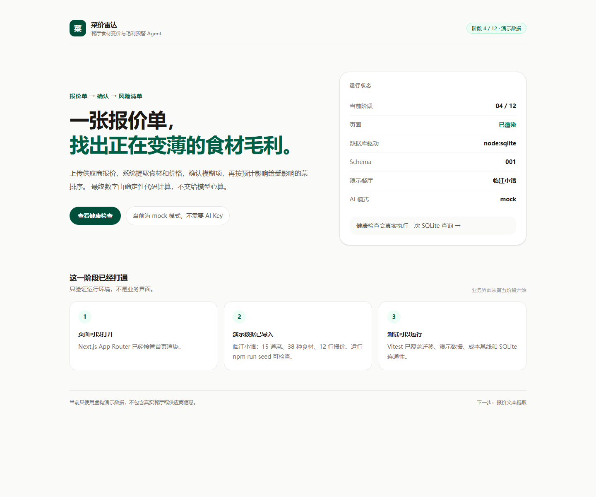

# 菜价雷达

> 餐厅食材变价与毛利预警 Agent  
> **上传一张供应商报价单，自动找出哪些菜因为食材涨价正在亏钱，并按预计损失金额排序。**

---

## 当前状态

| 项目 | 状态 |
|---|---|
| 当前阶段 | 第四阶段完成 |
| 项目进度 | 4 / 12 |
| 可运行应用 | 是 |
| 业务功能 | 尚未开始 |
| 数据库 | 15 张表；已导入 1 家虚构餐厅、15 道菜、38 种食材、12 行报价 |
| AI Key | 不需要；当前为 mock 模式 |
| Node.js | 24.22.1 |

> 首页只是运行骨架，不是最终报价界面。  
> 第五阶段开始做“粘贴报价文本 → 结构化提取”的最小页面。



---

## 快速启动

在项目根目录 `D:\hack\deepseek` 打开 PowerShell：

```powershell
npm install
npm run db:migrate
npm run seed
npm run dev
```

然后打开：

- 首页：http://localhost:3000
- 健康检查：http://localhost:3000/api/health

健康检查会真实打开一个内存 SQLite 数据库并执行 `SELECT 1`。正常结果类似：

```json
{
  "status": "ok",
  "app": "菜价雷达",
  "stage": 4,
  "stageLabel": "演示数据",
  "database": "ok",
  "checkedAt": "2026-11-05T05:15:52.808Z"
}
```

### 数据库命令和其他命令

```powershell
npm run db:migrate   # 创建或升级 data/app.db
npm run db:tables    # 列出数据库表
npm run seed         # 导入虚构演示数据；已存在时不重复
npm run demo:reset   # 删除并重建演示数据
npm test             # 运行 Vitest 测试
npm run typecheck    # TypeScript 类型检查
npm run build        # 生产构建
npm run start        # 启动生产构建
```

当前要求 Node.js 24 或更高版本，因为数据库驱动使用 Node 内置的 `node:sqlite`。

---

## 这个项目是什么

餐厅每周都会收到供应商的新报价。鸡腿、猪肉、土豆涨了几毛钱，看起来是小事，但落到每道菜、乘以一周销量，可能就是几百元的食材毛利损失。

菜价雷达只做一条链路：

```text
供应商报价单
  → 提取食材、价格、包装和单位
  → 匹配餐厅标准食材
  → 用户确认不确定项
  → 更新食材价格
  → 查询相关菜谱
  → 计算菜品食材成本和食材成本率
  → 按预计毛利影响排序
  → 生成有证据的处理建议
```

它**不做**：

- POS 接入；
- 库存管理；
- 自动采购；
- 自动修改菜单售价；
- 完整财务记账；
- 多门店和复杂权限；
- 通用餐饮助手。

---

## 先理解三个口径

### 1. 食材成本率

```text
食材成本率 = 单份食材成本 ÷ 菜品售价
```

### 2. 食材毛利率

```text
食材毛利率 = 1 − 食材成本率
```

### 3. 预计周食材毛利影响

```text
预计周食材毛利影响 = 单份成本变化 × 周销量
```

它表示食材涨价导致一周食材毛利减少多少，**不是净利润损失**。

本项目计算的是“核心食材成本”和“食材毛利”，不包含房租、人工、水电、平台抽佣和税费。页面和文档中不会把它冒充成完整经营利润。

缺少周销量时，系统只计算成本和成本率，**不会编造周毛利金额**。

---

## 当前目录

```text
src/app/                页面和接口
  page.tsx              当前运行骨架首页
  layout.tsx            全站布局和元数据
  globals.css           Tailwind 入口和基础样式
  api/health/route.ts   服务端健康检查接口

src/db/                 数据模型和访问基础设施
  client.ts             SQLite 连接和 PRAGMA 设置
  migrate.ts            迁移运行器
  inspect.ts            表名和迁移版本检查
  transaction.ts        事务包装
  types.ts              基础单位、状态和风险等级
  migrations/
    001_initial.sql     14 张业务/审计表
  seed/
    seed-demo.ts        演示数据导入和重置逻辑

src/lib/                通用基础设施
  app-meta.ts           项目名称、阶段等常量
  health.ts             SQLite 连通性检查

scripts/                数据库和演示命令
  db-migrate.mjs        执行迁移
  db-tables.mjs         列出表
  seed.mjs              导入演示数据
  reset-demo.mjs        重建演示数据

tests/                  测试
  health.test.ts        SQLite 和健康结果测试
  db-migration.test.ts  迁移、约束和事务测试
  demo-seed.test.ts     演示数据、成本基线和重置测试

docs/                   产品、计划、数据模型、演示文档
data/                   本地 SQLite 和固定演示数据
  app.db                本地数据库（被 Git 忽略）
  fixtures/
    demo-seed.json      虚构餐厅、菜品、报价和价格历史
```

后续会逐步增加：

```text
src/components/         可复用界面组件
src/domain/             纯业务规则：单位、成本、风险
src/agent/              Agent 状态机、编排、处理记录
src/providers/          AI 适配层：mock / 真实模型
public/                 静态资源
```

---

## 文档导览

| 文档 | 先看什么 | 作用 |
|---|---|---|
| [`docs/AGENT_SPEC.md`](docs/AGENT_SPEC.md) | 第 1、3、6、8、11 节 | 产品范围、Agent 流程、确认规则、计算公式、验收标准 |
| [`docs/DATA_MODEL.md`](docs/DATA_MODEL.md) | 第 1、2、18 节 | 每张表、每个字段、表关系和迁移说明 |
| [`docs/BUILD_PLAN.md`](docs/BUILD_PLAN.md) | 第 2、3、5 节 | 12 个阶段、当前进度、每阶段验收和需求追踪 |
| [`docs/DEMO_SCRIPT.md`](docs/DEMO_SCRIPT.md) | 第 1、2、3 节 | 7 分钟现场演示、虚构数据、预期结果和兜底方案 |
| `README.md` | 当前页 | 项目入口、启动方式和当前状态 |

推荐阅读顺序：

1. 本页；
2. `AGENT_SPEC.md` 的产品定位和 MVP 范围；
3. `DEMO_SCRIPT.md` 的演示主线；
4. `BUILD_PLAN.md` 的阶段和当前进度。

---

## 演示数据

演示使用一家完全虚构的餐厅：

- 餐厅：临江小馆
- 供应商：鲜源蔬菜配送
- 报价日期：2026-11-01
- 菜品：15 道
- 标准食材：20 种以上
- 报价：12 行

报价单里故意设计了一个不确定项：

> “土豆 1 箱 96 元”，但没有写一箱多少公斤。

系统会暂停，让用户确认“1 箱 = 20kg”，然后才能继续更新价格。

预期风险排序：

1. 宫保鸡丁 — 严重 — 预计周食材毛利影响 600.00 元
2. 红烧肉 — 警告 — 211.20 元
3. 青椒土豆丝 — 观察 — 132.00 元
4. 麻婆豆腐 — 观察 — 36.00 元
5. 番茄炒蛋 — 缺周销量，单独分组，不显示周损失金额

这些数字会在第四阶段写入种子数据，在第八阶段用自动化测试锁死。

---

## 技术栈

| 技术 | 版本 | 负责什么 |
|---|---|---|
| Node.js | 24.22.1 | 运行环境；内置 `node:sqlite` |
| Next.js | 16.4.5 | 页面、服务端 API、构建和启动 |
| React | 19.3.1 | 页面组件 |
| TypeScript | 5.9.3 | 数据结构、接口和计算类型 |
| Tailwind CSS | 4.3.4 | 演示界面样式 |
| SQLite | Node 内置 | 本地数据持久化，单文件，易重置 |
| SQL 迁移 | 001 | 表结构版本化和可重复建库 |
| Vitest | 5.1.0 | 单元测试和集成测试 |

设计原则：

- 模型负责读和解释，代码负责算和写；
- 关键数字不交给模型心算；
- 不确定就暂停，不猜；
- 缺数据就显示“无法计算”，不补默认值；
- 所有关键计算有自动化测试；
- 没有 AI Key 也能演示主流程。

---

## 第四阶段验证结果

| 检查项 | 结果 |
|---|---|
| `npm run db:migrate` | 成功，Schema `001` |
| `npm run seed` | 成功导入演示数据 |
| `npm run seed` 第二次 | 未重复写入 |
| `npm run demo:reset` | 删除并重建成功 |
| 演示餐厅 | 临江小馆 |
| 菜品 / 食材 / 报价行 | 15 / 38 / 12 |
| 历史价格 | 38 条 |
| 宫保鸡丁旧成本 | 10.00 元 |
| 红烧肉旧成本 | 10.04 元 |
| 青椒土豆丝旧成本 | 4.00 元 |
| 麻婆豆腐旧成本 | 3.50 元 |
| 番茄炒蛋旧成本 | 5.35 元 |
| `npm test` | 15 个测试通过 |
| `npm run typecheck` | 通过 |
| `npm run build` | 成功 |
| 首页 HTTP 状态 | 200 |
| `/api/health` HTTP 状态 | 200 |

---

## 下一步

**第五阶段：报价文本提取。**

第五阶段会做：

- 粘贴报价文本的最小页面；
- 一个“使用样例文本”按钮；
- 提取 API 和 mock 模式；
- 结构化提取结果表；
- 每个字段的证据和置信度；
- 低置信度字段的确认提示；
- 提取后只生成草稿，不修改正式价格。

在进入第五阶段之前，先运行 `npm run seed`，确认演示数据可以导入。

---

## 数据声明

本项目演示数据全部为虚构或匿名化数据，不包含真实餐厅、真实供应商、真实价格或个人信息。

如果以后接入真实报价，需要先确认数据使用和保密要求。

---

## 一句话总结

> 不是让 AI 算利润，而是让 AI 把报价读清楚，让代码把成本算准确，让用户决定是否接受变化，最后按损失大小告诉老板先处理哪道菜。
