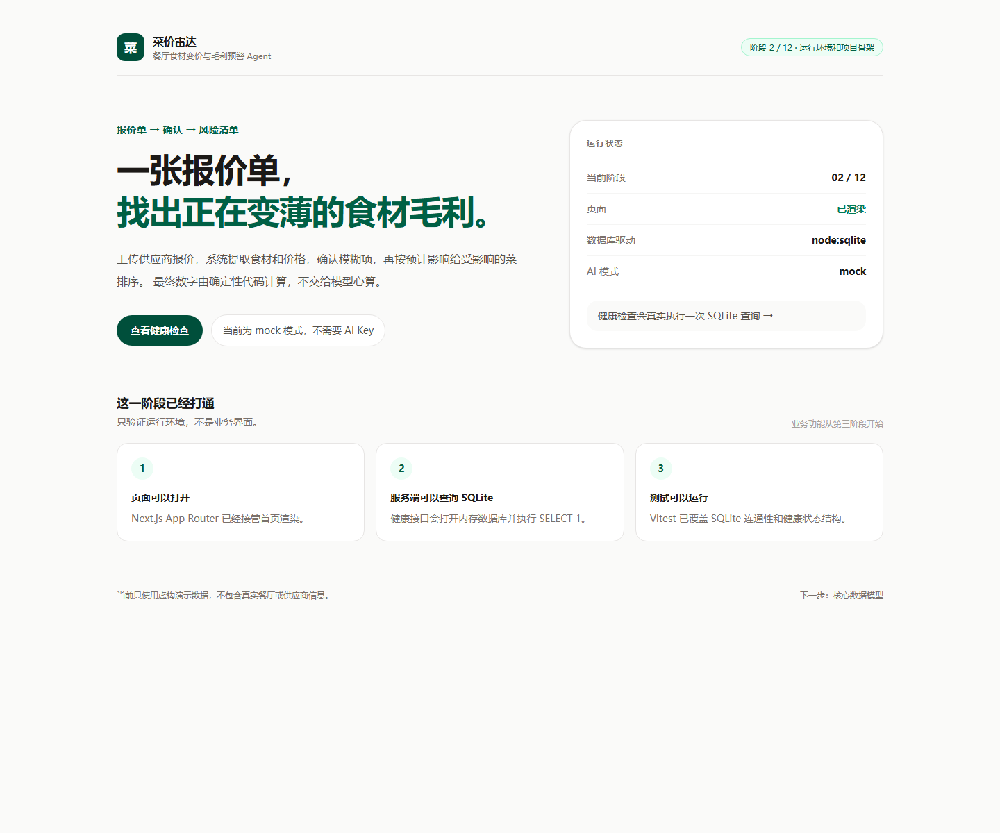

# 菜价雷达

> 餐厅食材变价与毛利预警 Agent  
> **上传一张供应商报价单，自动找出哪些菜因为食材涨价正在亏钱，并按预计损失金额排序。**

---

## 当前状态

| 项目 | 状态 |
|---|---|
| 当前阶段 | 第二阶段完成 |
| 项目进度 | 2 / 12 |
| 可运行应用 | 是 |
| 业务功能 | 尚未开始 |
| 数据库 | SQLite 驱动已验证；业务表尚未创建 |
| AI Key | 不需要；当前为 mock 模式 |
| Node.js | 24.22.1 |

> 首页只是运行骨架，不是最终报价界面。  
> 第三阶段才会开始建业务数据模型。



---

## 快速启动

在项目根目录 `D:\hack\deepseek` 打开 PowerShell：

```powershell
npm install
npm run dev
```

然后打开：

- 首页：http://localhost:3000
- 健康检查：http://localhost:3000/api/health

健康检查会真实打开一个内存 SQLite 数据库并执行 `SELECT 1`。正常结果类似：

```json
{
  "status": "ok",
  "app": "菜价雷达",
  "stage": 2,
  "stageLabel": "运行环境和项目骨架",
  "database": "ok",
  "checkedAt": "2026-11-05T05:15:52.808Z"
}
```

### 其他命令

```powershell
npm test          # 运行 Vitest 测试
npm run typecheck # TypeScript 类型检查
npm run build     # 生产构建
npm run start     # 启动生产构建
```

当前要求 Node.js 24 或更高版本，因为数据库驱动使用 Node 内置的 `node:sqlite`。

---

## 这个项目是什么

餐厅每周都会收到供应商的新报价。鸡腿、猪肉、土豆涨了几毛钱，看起来是小事，但落到每道菜、乘以一周销量，可能就是几百元的食材毛利损失。

菜价雷达只做一条链路：

```text
供应商报价单
  → 提取食材、价格、包装和单位
  → 匹配餐厅标准食材
  → 用户确认不确定项
  → 更新食材价格
  → 查询相关菜谱
  → 计算菜品食材成本和食材成本率
  → 按预计毛利影响排序
  → 生成有证据的处理建议
```

它**不做**：

- POS 接入；
- 库存管理；
- 自动采购；
- 自动修改菜单售价；
- 完整财务记账；
- 多门店和复杂权限；
- 通用餐饮助手。

---

## 先理解三个口径

### 1. 食材成本率

```text
食材成本率 = 单份食材成本 ÷ 菜品售价
```

### 2. 食材毛利率

```text
食材毛利率 = 1 − 食材成本率
```

### 3. 预计周食材毛利影响

```text
预计周食材毛利影响 = 单份成本变化 × 周销量
```

它表示食材涨价导致一周食材毛利减少多少，**不是净利润损失**。

本项目计算的是“核心食材成本”和“食材毛利”，不包含房租、人工、水电、平台抽佣和税费。页面和文档中不会把它冒充成完整经营利润。

缺少周销量时，系统只计算成本和成本率，**不会编造周毛利金额**。

---

## 当前目录

```text
src/app/                页面和接口
  page.tsx              当前运行骨架首页
  layout.tsx            全站布局和元数据
  globals.css           Tailwind 入口和基础样式
  api/health/route.ts   服务端健康检查接口

src/lib/                通用基础设施
  app-meta.ts           项目名称、阶段等常量
  health.ts             SQLite 连通性检查

tests/                  测试
  health.test.ts        SQLite 和健康结果测试

docs/                   产品、计划、演示文档
data/                   后续存放 SQLite 和上传原件（尚未创建）
scripts/                后续存放初始化脚本（尚未创建）
```

后续会逐步增加：

```text
src/components/         可复用界面组件
src/domain/             纯业务规则：单位、成本、风险
src/agent/              Agent 状态机、编排、处理记录
src/providers/          AI 适配层：mock / 真实模型
src/db/                 数据模型、迁移、查询、事务
public/                 静态资源
```

---

## 文档导览

| 文档 | 先看什么 | 作用 |
|---|---|---|
| [`docs/AGENT_SPEC.md`](docs/AGENT_SPEC.md) | 第 1、3、6、8、11 节 | 产品范围、Agent 流程、确认规则、计算公式、验收标准 |
| [`docs/BUILD_PLAN.md`](docs/BUILD_PLAN.md) | 第 2、3、5 节 | 12 个阶段、当前进度、每阶段验收和需求追踪 |
| [`docs/DEMO_SCRIPT.md`](docs/DEMO_SCRIPT.md) | 第 1、2、3 节 | 7 分钟现场演示、虚构数据、预期结果和兜底方案 |
| `README.md` | 当前页 | 项目入口、启动方式和当前状态 |

推荐阅读顺序：

1. 本页；
2. `AGENT_SPEC.md` 的产品定位和 MVP 范围；
3. `DEMO_SCRIPT.md` 的演示主线；
4. `BUILD_PLAN.md` 的阶段和当前进度。

---

## 演示数据

演示使用一家完全虚构的餐厅：

- 餐厅：临江小馆
- 供应商：鲜源蔬菜配送
- 报价日期：2026-11-01
- 菜品：15 道
- 标准食材：20 种以上
- 报价：12 行

报价单里故意设计了一个不确定项：

> “土豆 1 箱 96 元”，但没有写一箱多少公斤。

系统会暂停，让用户确认“1 箱 = 20kg”，然后才能继续更新价格。

预期风险排序：

1. 宫保鸡丁 — 严重 — 预计周食材毛利影响 600.00 元
2. 红烧肉 — 警告 — 211.20 元
3. 青椒土豆丝 — 观察 — 132.00 元
4. 麻婆豆腐 — 观察 — 36.00 元
5. 番茄炒蛋 — 缺周销量，单独分组，不显示周损失金额

这些数字会在第四阶段写入种子数据，在第八阶段用自动化测试锁死。

---

## 技术栈

| 技术 | 版本 | 负责什么 |
|---|---|---|
| Node.js | 24.22.1 | 运行环境；内置 `node:sqlite` |
| Next.js | 16.4.5 | 页面、服务端 API、构建和启动 |
| React | 19.3.1 | 页面组件 |
| TypeScript | 5.9.3 | 数据结构、接口和计算类型 |
| Tailwind CSS | 4.3.4 | 演示界面样式 |
| SQLite | Node 内置 | 本地数据持久化，单文件，易重置 |
| Vitest | 5.1.0 | 单元测试和集成测试 |

设计原则：

- 模型负责读和解释，代码负责算和写；
- 关键数字不交给模型心算；
- 不确定就暂停，不猜；
- 缺数据就显示“无法计算”，不补默认值；
- 所有关键计算有自动化测试；
- 没有 AI Key 也能演示主流程。

---

## 第二阶段验证结果

| 检查项 | 结果 |
|---|---|
| `npm install` | 成功 |
| `npm test` | 2 个测试通过 |
| `npm run typecheck` | 通过 |
| `npm run build` | 成功 |
| `npm run dev` | 启动成功 |
| 首页 HTTP 状态 | 200 |
| `/api/health` HTTP 状态 | 200 |
| 健康检查中的 SQLite | `ok` |
| Git 仓库 | 已初始化 |

---

## 下一步

**第三阶段：核心数据模型。**

第三阶段会创建：

- 餐厅、供应商、标准食材、食材别名；
- 单位换算；
- 报价和报价行；
- 价格历史；
- 菜品和菜谱用量；
- 用户确认、分析快照和审计事件；
- `docs/DATA_MODEL.md`。

在进入第三阶段之前，先把首页和健康检查跑一遍，确认运行环境正常。

---

## 数据声明

本项目演示数据全部为虚构或匿名化数据，不包含真实餐厅、真实供应商、真实价格或个人信息。

如果以后接入真实报价，需要先确认数据使用和保密要求。

---

## 一句话总结

> 不是让 AI 算利润，而是让 AI 把报价读清楚，让代码把成本算准确，让用户决定是否接受变化，最后按损失大小告诉老板先处理哪道菜。
