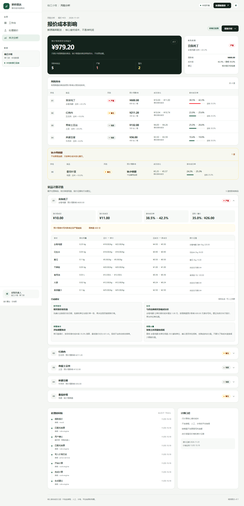

# 菜价雷达

> 餐厅食材变价与毛利预警 Agent
> **上传一张供应商报价单，自动找出哪些菜因为食材涨价正在亏钱，并按预计损失金额排序。**

---

## 当前状态

| 项目 | 状态 |
|---|---|
| 当前阶段 | 项目完成 |
| 项目进度 | 12 / 12 |
| 可运行应用 | 是 |
| 业务功能 | 图片/PDF/文本提取；食材匹配；确认；价格应用；成本计算；风险排序；建议；审计 |
| 数据库 | 15 张表；演示数据已导入；分析快照和审计记录完整 |
| AI Key | 不需要；默认 mock 模式 |
| Node.js | 24.22.1 |

> 完整流程：报价页 `/quotes/new` → 匹配确认 → 计算风险 → 风险看板 `/quotes/[id]`。
> 当前 mock 模式只识别内置样例图片；电子 PDF 会真实抽取文字层；任意图片需要配置视觉模型。
> 计算的是核心食材成本，不是房租、人工和水电后的净利润。



---

## 快速启动

在项目根目录打开 PowerShell：

```powershell
npm install
npm run db:migrate
npm run seed
npm run dev
```

然后打开：

- 首页：http://localhost:3000
- 报价页：http://localhost:3000/quotes/new
- 健康检查：http://localhost:3000/api/health

### 完整演示流程

1. 打开 `http://localhost:3000/quotes/new`；
2. 点击“使用样例文本”（或样例图片/PDF）；
3. 点击“提取报价草稿”；
4. 系统自动匹配 12 行标准食材，并停在土豆包装问题；
5. 输入 `20`，单位选 `kg`，勾选“记住这个包装换算”；
6. 点击“确认并继续”；
7. 点击“计算毛利风险”；
8. 进入 `/quotes/[id]` 风险看板；
9. 查看排序、菜品详情、报价证据、计算过程和行动建议；
10. 运行 `npm run demo:reset` 恢复初始演示数据。

预期核心结果：

- 宫保鸡丁：严重，预计周影响 `¥600.00`；
- 红烧肉：警告，`¥211.20`；
- 青椒土豆丝：观察，`¥132.00`；
- 麻婆豆腐：观察，`¥36.00`；
- 番茄炒蛋：缺少周销量，单独分组，不显示周损失金额。

健康检查会真实打开一个内存 SQLite 数据库并执行 `SELECT 1`。正常结果类似：

```json
{
  "status": "ok",
  "app": "菜价雷达",
  "stage": 12,
  "stageLabel": "测试、演示和交付",
  "database": "ok",
  "checkedAt": "2026-11-05T05:15:52.808Z"
}
```

### 数据库命令和其他命令

```powershell
npm run db:migrate   # 创建或升级 data/app.db
npm run db:tables    # 列出数据库表
npm run seed         # 导入虚构演示数据；已存在时不重复
npm run demo:reset   # 删除并重建演示数据
npm test             # 运行 Vitest 测试
npm run typecheck    # TypeScript 类型检查
npm run build        # 生产构建
npm run start        # 启动生产构建
```

当前要求 Node.js 24 或更高版本，因为数据库驱动使用 Node 内置的 `node:sqlite`。

---

## 这个项目是什么

餐厅每周都会收到供应商的新报价。鸡腿、猪肉、土豆涨了几毛钱，看起来是小事，但落到每道菜、乘以一周销量，可能就是几百元的食材毛利损失。

菜价雷达只做一条链路：

```text
供应商报价单
  → 提取食材、价格、包装和单位
  → 匹配餐厅标准食材
  → 用户确认不确定项
  → 更新食材价格
  → 查询相关菜谱
  → 计算菜品食材成本和食材成本率
  → 按预计毛利影响排序
  → 生成有证据的处理建议
```

它**不做**：

- POS 接入；
- 库存管理；
- 自动采购；
- 自动修改菜单售价；
- 完整财务记账；
- 多门店和复杂权限；
- 通用餐饮助手。

---

## 先理解三个口径

### 1. 食材成本率

```text
食材成本率 = 单份食材成本 ÷ 菜品售价
```

### 2. 食材毛利率

```text
食材毛利率 = 1 − 食材成本率
```

### 3. 预计周食材毛利影响

```text
预计周食材毛利影响 = 单份成本变化 × 周销量
```

它表示食材涨价导致一周食材毛利减少多少，**不是净利润损失**。

本项目计算的是“核心食材成本”和“食材毛利”，不包含房租、人工、水电、平台抽佣和税费。页面和文档中不会把它冒充成完整经营利润。

缺少周销量时，系统只计算成本和成本率，**不会编造周毛利金额**。

---

## 当前目录

```text
src/app/                页面和接口
  page.tsx              当前运行骨架首页
  layout.tsx            全站布局和元数据
  globals.css           Tailwind 入口和基础样式
  quotes/new/page.tsx   报价输入与确认页
  quotes/[id]/page.tsx  风险看板、菜品详情、证据、建议和时间线
  api/health/route.ts   服务端健康检查
  api/quotes/extract/   报价文本提取 API
  api/quotes/upload/    图片/PDF 上传提取 API
  api/quotes/[id]/source/  原件预览 API
  api/quotes/[id]/standardize/  食材匹配和换算 API
  api/quotes/[id]/confirmations/ 用户确认 API
  api/quotes/[id]/analyze/     应用价格和分析 API

src/components/         界面组件
  quote-extraction-form.tsx  上传、粘贴、提取、原件预览
  standardization-panel.tsx  匹配表、确认问题和记忆操作
  analyze-button.tsx         应用价格并计算风险

src/domain/             纯业务规则
  normalize.ts          名称标准化
  money.ts              元字符串 → 整数微元
  quantity.ts           十进制数量缩放
  unit-conversion.ts    单位/包装换算和价格归一化
  ingredient-matching.ts 别名/名称匹配
  quote-extraction.ts   提取 schema、置信度和问题类型
  standardization.ts    标准化结果、确认问题、确认输入 schema
  costing.ts            单份成本、成本率、周影响
  risk.ts               风险等级和默认阈值
  analysis.ts           分析快照、建议和看板类型

src/agent/              Agent 编排
  extract-quote.ts      文本提取入口
  extract-quote-file.ts 图片/PDF 提取入口
  save-quote-draft.ts   共享草稿保存和审计逻辑
  standardize-quote.ts  规则匹配、换算、异常价格检查
  confirm-quote.ts      确认记录、别名/换算记忆
  apply-quote-prices.ts 确认后写入价格历史
  analyze-quote.ts      成本计算、风险排序、建议和快照

src/providers/          AI/解析适配层
  quote-extraction-provider.ts  文本提供方接口
  mock-quote-provider.ts        mock 确定性解析
  openai-quote-provider.ts      OpenAI-compatible 文本适配器
  quote-vision-provider.ts      视觉提供方接口
  openai-vision-provider.ts     OpenAI-compatible 视觉适配器
  index.ts                      模式选择

src/db/                 数据模型和访问基础设施
  client.ts             SQLite 连接和 PRAGMA 设置
  migrate.ts            迁移运行器
  inspect.ts            表名和迁移版本检查
  transaction.ts        事务包装
  types.ts              基础单位、状态和风险等级
  migrations/
    001_initial.sql     14 张业务/审计表
  seed/
    seed-demo.ts        演示数据导入和重置逻辑

src/lib/                通用基础设施
  app-meta.ts           项目名称、阶段等常量
  health.ts             SQLite 连通性检查
  demo-quote-text.ts    演示报价文本
  demo-files.ts         样例图片哈希和样例路径
  quote-files.ts        上传保存、路径校验和原件读取
  pdf.ts                电子 PDF 文字层提取
  quote-report.ts       看板查询和快照反序列化

scripts/                数据库和演示命令
  db-migrate.mjs        执行迁移
  db-tables.mjs         列出数据库表
  seed.mjs              导入演示数据
  reset-demo.mjs        重建演示数据

tests/                  测试
  health.test.ts        SQLite 和健康结果测试
  db-migration.test.ts  迁移、约束和事务测试
  demo-seed.test.ts     演示数据、成本基线和重置测试
  money.test.ts         金额字符串精度测试
  extraction.test.ts    文本提取、置信度、草稿保存测试
  file-extraction.test.ts 图片/PDF 上传和原件测试
  unit-conversion.test.ts 数量缩放、单位/包装换算测试
  ingredient-matching.test.ts 别名、名称和歧义匹配测试
  standardization.test.ts 标准化、确认、记忆和异常价格测试
  costing.test.ts       单份成本和缺数据测试
  risk.test.ts          风险分级和阈值测试
  analysis.test.ts      价格应用、排序、快照和重复分析测试

docs/                   产品、计划、数据模型、演示文档
data/                   本地 SQLite、固定演示数据和上传原件
  app.db                本地数据库（被 Git 忽略）
  fixtures/
    demo-seed.json      虚构餐厅、菜品、报价和价格历史
  uploads/              运行时上传原件（被 Git 忽略）

public/samples/         可下载的样例报价单
  demo-quote.png
  demo-quote.pdf
```

当前目录就是 MVP 的完整实现，不再提前创建空目录。

---

## 文档导览

| 文档 | 先看什么 | 作用 |
|---|---|---|
| [`docs/AGENT_SPEC.md`](docs/AGENT_SPEC.md) | 第 1、3、6、8、11 节 | 产品范围、Agent 流程、确认规则、计算公式、验收标准 |
| [`docs/DATA_MODEL.md`](docs/DATA_MODEL.md) | 第 1、2、18 节 | 每张表、每个字段、表关系和迁移说明 |
| [`docs/BUILD_PLAN.md`](docs/BUILD_PLAN.md) | 第 2、3、5 节 | 12 个阶段、当前进度、每阶段验收和需求追踪 |
| [`docs/DEMO_SCRIPT.md`](docs/DEMO_SCRIPT.md) | 第 1、2、3 节 | 7 分钟现场演示、虚构数据、预期结果和兜底方案 |
| `README.md` | 当前页 | 项目入口、启动方式和当前状态 |

推荐阅读顺序：

1. 本页；
2. `AGENT_SPEC.md` 的产品定位和 MVP 范围；
3. `DEMO_SCRIPT.md` 的演示主线；
4. `BUILD_PLAN.md` 的阶段和当前进度。

---

## 演示数据

演示使用一家完全虚构的餐厅：

- 餐厅：临江小馆
- 供应商：鲜源蔬菜配送
- 报价日期：2026-11-01
- 菜品：15 道
- 标准食材：20 种以上
- 报价：12 行

报价单里故意设计了一个不确定项：

> “土豆 1 箱 96 元”，但没有写一箱多少公斤。

系统会暂停，让用户确认“1 箱 = 20kg”，然后才能继续更新价格。

预期风险排序：

1. 宫保鸡丁 — 严重 — 预计周食材毛利影响 600.00 元
2. 红烧肉 — 警告 — 211.20 元
3. 青椒土豆丝 — 观察 — 132.00 元
4. 麻婆豆腐 — 观察 — 36.00 元
5. 番茄炒蛋 — 缺周销量，单独分组，不显示周损失金额

这些数字已经由种子数据、成本引擎和自动化测试锁定。

---

## 技术栈

| 技术 | 版本 | 负责什么 |
|---|---|---|
| Node.js | 24.22.1 | 运行环境；内置 `node:sqlite` |
| Next.js | 16.4.5 | 页面、服务端 API、构建和启动 |
| React | 19.3.1 | 页面组件 |
| TypeScript | 5.9.3 | 数据结构、接口和计算类型 |
| Tailwind CSS | 4.3.4 | 演示界面样式 |
| SQLite | Node 内置 | 本地数据持久化，单文件，易重置 |
| SQL 迁移 | 001 | 表结构版本化和可重复建库 |
| Zod | 4.6.7 | 提取 API 输入和模型输出校验 |
| unpdf | 2.1.0 | 电子 PDF 文字层提取 |
| Vitest | 5.1.0 | 单元测试和集成测试 |

设计原则：

- 模型负责读和解释，代码负责算和写；
- 关键数字不交给模型心算；
- 不确定就暂停，不猜；
- 缺数据就显示“无法计算”，不补默认值；
- 所有关键计算有自动化测试；
- 没有 AI Key 也能演示主流程。

---

## 最终验证结果

| 检查项 | 结果 |
|---|---|
| 三种输入 | 文本、样例图片、电子 PDF 均可提取 12 行 |
| 自动匹配 | 12 / 12 行匹配到标准食材 |
| 包装确认 | 1 箱土豆确认 20kg → 20,000g，¥4.80/kg |
| 价格应用 | 12 条价格历史写入，重复分析不重复写 |
| 成本计算 | 宫保鸡丁 10.00 → 11.00，成本率 38.5% → 42.3% |
| 周影响 | 宫保 600.00、红烧肉 211.20、土豆丝 132.00、麻婆 36.00 |
| 风险排序 | 严重 → 警告 → 观察；缺销量的番茄炒蛋单独分组 |
| 毛利总额 | 预计周食材毛利减少 ¥979.20（仅 A 组） |
| 菜品详情 | 报价证据、菜谱用量、旧/新单价、成本率、建议、时间线 |
| 价格历史 | 分析前 38 条，应用后 50 条；重置后恢复 38 条 |
| `npm test` | 54 个测试通过 |
| `npm run typecheck` | 通过 |
| `npm run build` | 成功，11 条路由 |
| 页面手工验收 | 提取 → 确认 → 计算风险 → 看板完整走通 |
| Git 工作区 | 干净 |

---

## 当前边界

- AI 候选匹配和建议文案仍是规则/模板实现，真实模型适配器已保留。
- mock 模式只识别内置样例图片；任意图片需要视觉模型。
- 扫描 PDF 不自动 OCR，需要改用图片或粘贴文本。
- 多页 PDF 的证据页码暂不精确到每一行。
- 没有登录、权限、多门店、POS、库存、自动改价或自动下单。
- 计算的是核心食材成本，不是包含房租、人工和水电的净利润。

---

## MVP 已完成

当前版本已经能完成这条演示链路：

```text
上传/粘贴报价
  → 提取
  → 匹配和换算
  → 用户确认
  → 应用价格历史
  → 计算成本和风险
  → 按预计影响排序
  → 查看菜品证据、计算过程和行动建议
```

现场演示时，先运行 `npm run demo:reset`，再从 `/quotes/new` 开始。

---

## 数据声明

本项目演示数据全部为虚构或匿名化数据，不包含真实餐厅、真实供应商、真实价格或个人信息。

如果以后接入真实报价，需要先确认数据使用和保密要求。

---

## 一句话总结

> 不是让 AI 算利润，而是让 AI 把报价读清楚，让代码把成本算准确，让用户决定是否接受变化，最后按损失大小告诉老板先处理哪道菜。
